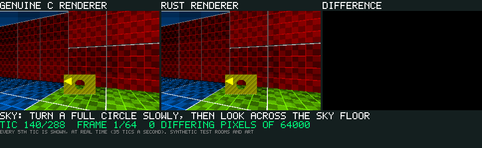

# Rust DOOM

A rewrite of the original DOOM engine in Rust that aims to behave exactly like id
Software's code, down to every single step of game logic. (Rust DOOM is a working title.)

> **Machine-Maintained, Human-Directed Project**
>
> This project is developed and maintained primarily by AI coding agents under
> human direction and oversight. Agents implement code, write tests, maintain
> documentation, and assist with development workflows.
>
> Changes are subject to automated validation and human-defined review
> requirements. AI-generated code can contain mistakes, and passing tests does
> not guarantee correctness. This project is not affiliated with id Software or
> Bethesda.


*A synthetic test run replayed by the original engine's code and the Rust engine, tic by tic, from real values of both ([how](docs/TESTING.md#m4b-synthetic-mechanism-wads)).*



*Both renderers drawing the same walks through three synthetic test rooms (walls, floors, sky, sprites, fuzz) with our own generated test art, not the game's: every frame is byte-identical, so the difference panel stays black ([how](docs/TESTING.md#readme-animations)).*


*The genuine engine and the Rust port play one scripted session on a synthetic room with our own generated test art, not the game's: all 155 tics, with the status bar, message and palette numbers, are identical to the genuine engine under the declared sound-free, wipe-free contract, so the difference panel stays black ([how](docs/TESTING.md#readme-animations)).*

## Why this exists

Most source ports (modern rewrites of a game's released source code) aim to be playable first and accurate second. This
project works the other way round. It only accepts behavior checked against the original Linux DOOM 1.10 C code (id
Software's 1997 source release), comparing the entire game state after every tic, the 1/35-second step in which DOOM
updates its world. Anything not yet proven identical is refused: the engine stops with an error instead of approximating.

That makes it fit for exact-behavior work once the ground is covered: replaying recorded demos (files of a player's
inputs, which stay in sync only if every tic matches), speedrun and tool-assisted (TAS) research, and studying the
original engine. Vanilla behavior (the original unmodified game, quirks included) is the default, and game math stays in
Doom's whole-number arithmetic (one division aside). Once a behavior is admitted, nothing quietly rounds it differently.

**It is only playable in a limited way** (one Episode 1 map at a time, no sound or menus; see [Play
it](#play-it-limited)). To really play Doom, use an established source port such as [Chocolate
Doom](https://www.chocolate-doom.org/). Like every engine, this one needs your own game files.

## Where it stands

The engine runs DOOM's game logic, draws the 3D view with the status bar and messages, and a limited playable build opens
a window for one Episode 1 map at a time. It is checked by tests and small example programs, on small test maps built for
this project and, locally, on all nine real Episode 1 maps. Today it can simulate:

- one player who moves, uses switches and doors, takes damage and dies, with the fist, pistol, shotgun and chaingun,
  against the Demon, Zombieman, Shotgun Guy, Chaingunner and Imp, which see, chase, attack and fight each other, plus
  ammunition, health, armor and bonus pickups;
- walls at any angle, steps and ledges, windows, sky, damaging floors, secrets, flickering lights and scrolling walls;
- E1M1's doors, lifts, floors, switches, exit, lamps, pillars, corpses and exploding barrels (with chain reactions),
  then every Episode 1 door, floor, lift, stair, donut, light and exit special, keys, powerups, the chainsaw, the rocket
  launcher, the Spectre, teleporters, the Baron of Hell, the E1M8 boss floor and hard skill (3);
- all nine real Episode 1 maps, E1M1 to E1M9, on skills 2 and 3, plus the original's own `DEMO1` as run by the original
  code. All 61 scripted runs (idle, exit walks, fights, deaths, random commands) run in sync with the genuine
  engine (the original C code, built and run alongside the Rust code), tic for tic, using your own game files, local-only
  ([evidence](docs/validation/M4B.md#real-maps-and-demo1));
- a software renderer for the 3D view that draws the same image as the original code on the test maps and on every frame
  of those scripted runs (local-only), leaving out screen columns where the original reads undefined memory and 105
  test-map frames with an unrecorded switch state ([support](docs/COMPATIBILITY.md#software-renderer-m5a));
- a status bar, messages, palette flashes, keyboard-and-mouse input and a window at 35 tics a second. Frames are identical
  to the genuine engine under the declared sound-free, wipe-free contract, except 300 synthetic frames compared only on
  the columns it defines, 70 not compared, and 494 and 552 real-map frames compared that way (size 10, size 11); the
  sessions checked replay in it ([support](docs/COMPATIBILITY.md#playable-build-m5b), [evidence](docs/validation/M5B.md));
- on those maps, one tic of the simulation takes about 33–150 µs on an Intel Core i7-8750H laptop CPU (6 cores, 2.2 GHz,
  Linux under WSL2), 1.8 to 7 times faster than before, every result unchanged
  ([measurements](docs/validation/M4P.md#matched-timing)).

What it cannot do yet:

- draw the automap, play sound or offer menus, an intermission or a next level, or play back the original's recorded demos
  (only the one local `DEMO1`, as run by the original code, is covered);
- claim a tic-for-tic match for every input (only the scripted runs recorded so far), handle the other episodes or easy or
  nightmare skill, or reach every corner of a map the scripted runs do not.

This is a long-term project: progress is measured in proven features, not weeks.

## Which kind of Doom?

Four broad ways to play classic Doom; each non-vanilla one would be a separate optional mode.

- **Vanilla.** The original 1993 game, limits and quirks included: what this project builds.
- **Limit-removing.** Same game, but the original's hard limits on map size are lifted (Track 1 below).
- **Boom, MBF21 and ID24.** Extensions adding new doors, lifts and floors: a possible later mode.
- **Advanced, ZDoom-style.** Scripting, slopes and big mods: this project would go its own way (Track 3 below).

## Where it's (maybe) going

Ideas, not promises, one line each; the [roadmap](docs/ROADMAP.md#ideas-under-consideration) has more.

**Track 1: Faithful.** Vanilla stays exact; anything that changes it lives in a separate optional mode.

- **Original demo playback.** Replay vanilla demos to the last tic, the strongest proof of exactness.
- **Faster progress.** Port whole systems at once, checked on real maps and demos.
- **One vanilla mode, plus a limit-removing one.** Fold the policies into one; another lifts limits.
- **An optional "fixed" mode.** Off unless chosen, it would correct known original bugs.
- **The full game and Doom II.** After Episode 1, the other episodes and Doom II, just as exact.

**Track 2: Presentation.** The renderer only reads game state, so it can never change gameplay.

- **A faithful software renderer first.** It would look exactly like the original Linux DOOM 1.10.
- **Then a modern renderer.** Smooth high frame rates between tics, plus sector-based lighting.
- **VR.** A headset handles looking around while the mouse turns and aims.
- **A fully offline engine.** Your own game files, no internet, account or launcher.

**Track 3: Beyond vanilla.** A new engine on the verified core, in separate optional modes.

- **Modern source-port features, done cleanly.** ZDoom-style features on a fresh core.
- **Things the original never simulated.** Flowing water, blood and nukage; huge monster crowds.
- **Scripting and more platforms.** A scripting layer for new game logic; platforms such as mobile.
- **A live editor with rewind.** Change anything while the game runs, then rewind and replay from any moment.
- **"Why did that happen?"** Click a monster and see the exact decisions and random rolls behind what it did.
- **TAS tools that are vanilla-legal by construction.** Runs built frame by frame here play back on the original game.
- **Map and demo checks.** See exactly which line breaks vanilla limits, and which demos a map change desyncs.

## How it's verified

The original C source is the ground truth. Each supported behavior is run in both the original code and the Rust code, and
the whole game state is compared after every tic. The expected results are recorded by a separate program written from the
C output alone, so Rust is never checked against its own output. Sanitizers catch hidden memory and arithmetic errors
while the original C code runs, fuzzing feeds in huge numbers of random inputs, and mutation testing, which deliberately
breaks the code, checks that the tests notice. Anything not proven identical is refused, not guessed.

## Play it (limited)

The `doom-play` program opens a window for one Episode 1 map (E1M1 to E1M9; skill `hmp` or `uv`). You need your own
`DOOM.WAD` (read in place, never distributed). From the cloned top folder (`--help` lists every option):

```sh
cargo run --release -p doom-play -- --iwad /path/to/DOOM.WAD --map 1 --skill hmp --sessions /path/for/sessions
```

- **Controls.** The original's defaults: arrows move and turn, right Ctrl fires, Space uses, right Shift runs, `1`-`8`
  pick weapons, mouse left fires (`--bindings modern` gives WASD). Esc pauses (R restarts, Q quits). Cheat codes do nothing.
- **Sessions.** Each is saved as a demo (`E1M1-skill2-<UTC time>.lmp`), never over an existing file. Demos store turns in
  steps of 256 units, so tiny mouse turns are rounded or lost; the opt-in `--unrecorded-full-turning` keeps them but records nothing
  ("not recorded: no demo, cannot be replayed"). With your IWAD and a C compiler, `python3 tools/local/m5b_session_real.py
  --iwad /path/to/DOOM.WAD --lmp FILE.lmp` (add `--screenblocks 11` if you used it) replays a saved session in the genuine
  engine and prints `VERDICT: PASS` or the first tic that differs.
- **Missing.** Sound, menus, automap, saving, intermission, next level, wipes, easy and nightmare skill, multiplayer.
- **Limits.** The status bar face's idle left, ahead or right glance differs from a vanilla session with sound until sound
  is modelled; nothing else on screen is affected. **An OpenGL 2.1 (or OpenGL ES 2) driver is required.** The window library reports focus
  loss and the game then pauses and releases every held key: seen under WSLg when a second window took the focus; Alt-Tab,
  minimising by hand, Windows, macOS and whether keys are seen released are unchecked, so press Esc first.
- **Not yet judged.** Under Linux (WSLg) it starts, loads the real game and plays scripted and idle sessions that replay
  identically. Nobody has looked at the picture, pressed a real key, moved a real mouse, tried mouse capture, or run it on
  Windows or macOS beyond CI builds (nobody has run the CI-built `doom-play.exe`), so how it looks and feels is unknown.

## Try it

You need Rust via [rustup](https://rustup.rs/) (stable, or at least 1.85.0) and a C compiler (on Windows, the Visual
Studio build tools) for a small test-only compression library. It builds on Linux, Windows and macOS. From the cloned top
folder, build, test and run three scripted examples (each prints a one-line summary; none needs game files, graphics,
audio or a network):

```sh
cargo build --workspace --locked
cargo test --workspace --locked
cargo run -p doom-sim --example player_barrels --locked  # exploding barrels, chain reactions, monsters
cargo run -p doom-sim --example player_movers --locked   # a player, monsters, doors, lifts and the exit
cargo run -p doom-map --example parse_map --locked       # reading DOOM's map format
```

## Policies (for developers)

New gameplay is switched on through optional policies, each selected explicitly and adding one slice of Doom to the one
before. Older policies never change, so earlier results stay reproducible, much like compatibility levels. The number in
brackets is the policy's identifier in saved test snapshots; earlier Demon profiles are under [versioned
profiles](docs/COMPATIBILITY.md#versioned-gameplay-profiles).

| Policy (wire ID) | Adds | Contract |
| --- | --- | --- |
| `DemonNormalV1` (1) | The bounded Demon closure with original actor types and states stored directly | [Original-ID Demon](docs/COMPATIBILITY.md#original-id-demon-profile) |
| `PlayerBodyLifecycleV1` (2) | One genuine original player body: direct damage, pain, death and a retained corpse | [Player body](docs/COMPATIBILITY.md#original-player-body-lifecycle) |
| `PlayerBodyKnockbackV1` (3) | Physical knockback and grounded wall collision for that player | [Knockback](docs/COMPATIBILITY.md#original-player-grounded-knockback) |
| `PlayerCommandMovementV1` (4) | Player commands (turning, thrust) and the source reaction-time delay | [Command movement](docs/COMPATIBILITY.md#original-player-command-movement) |
| `PlayerDemonAcquisitionV1` (5) | One Demon that sees and pursues the active player, without melee | [Acquisition](docs/COMPATIBILITY.md#active-original-player-and-demon-acquisition) |
| `PlayerDemonMeleeV1` (6) | Source-timed Demon melee against the player, with damage, pain and death | [Demon melee](docs/COMPATIBILITY.md#autonomous-original-demon-player-melee) |
| `PlayerDemonPistolV1` (7) | The genuine pistol: psprites, ammunition, refire spread, hitscan and noise alerts | [Pistol](docs/COMPATIBILITY.md#genuine-player-pistol-combat) |
| `PlayerDemonWeaponsV1` (8) | Fists, shotgun, chaingun, weapon fallback and manual switching | [Weapons](docs/COMPATIBILITY.md#original-player-weapon-expansion) |
| `PlayerDemonPickupsV1` (9) | World ammunition, stimpacks, medikits and shotgun/chaingun pickups | [Pickups](docs/COMPATIBILITY.md#original-world-pickups) |
| `PlayerDemonArmorV1` (10) | Green and blue armor with source absorption and depletion | [Armor](docs/COMPATIBILITY.md#original-armor-and-damage-absorption) |
| `PlayerDemonBonusesV1` (11) | Health and armor bonuses (+1 up to 200) and counted-item statistics | [Bonuses](docs/COMPATIBILITY.md#original-health-and-armor-bonuses) |
| `PlayerMonstersV1` (12) | Former humans beside the Demon, up to eight monsters, infighting and item drops | [Former humans](docs/COMPATIBILITY.md#original-former-humans-and-multi-monster-encounters) |
| `PlayerMonstersImpV1` (13) | The Imp and its dodgeable fireball | [Imps](docs/COMPATIBILITY.md#original-imps-and-fireballs) |
| `PlayerMonstersMapScaleV1` (14) | Travel bounded by the loaded walls in walled rooms up to 2,048 units | [Map scale](docs/COMPATIBILITY.md#original-monsters-at-real-map-scale) |
| `PlayerMonstersHeightsV1` (15) | Static floor/ceiling heights joined by two-sided lines: steps, ledges, windows, falls | [Static heights](docs/COMPATIBILITY.md#original-monsters-with-static-heights) |
| `PlayerMonstersDiagonalV1` (16) | Linedefs of any direction inside a closed boundary; one corner jump refused | [Diagonal walls](docs/COMPATIBILITY.md#original-monsters-among-diagonal-walls) |
| `PlayerMonstersRealMapV1` (17) | WAD-format geometry limits (E1M1-sized) under a per-map arithmetic certificate | [Classic-map scale](docs/COMPATIBILITY.md#original-monsters-at-classic-map-scale) |
| `PlayerMonstersSpecialsV1` (18) | Sky ceilings, light thinkers, damage floors, secrets and one-sided scrolling walls | [Sky and specials](docs/COMPATIBILITY.md#original-monsters-with-sky-and-static-specials) |
| `PlayerMonstersMoversV1` (19) | E1M1's seven door, lift, floor, switch and exit line types; the tic after the exit is refused | [Movers](docs/COMPATIBILITY.md#original-monsters-with-doors-lifts-floors-switches-and-the-exit) |
| `PlayerMonstersE1M1V1` (20) | Two-sided scrolling walls and E1M1's seven static decoration types (lamps, pillars, candelabras, corpses and gore) | [E1M1 decorations](docs/COMPATIBILITY.md#original-monsters-with-two-sided-scrolling-walls-and-static-decorations) |
| `PlayerMonstersBarrelsV1` (21) | Exploding barrels with the original's radius attack and chain reactions, 64 pickups, every map-thing angle and the relaxed spawn rule | [Barrels](docs/COMPATIBILITY.md#original-monsters-with-exploding-barrels-pickup-scale-and-every-thing-angle) |
| `PlayerMonstersLevelV1` (22) | The player start at its place in the map's thing list, with its angle; the full player think, including damage-flash decay and the dead player's turn toward its attacker: the real E1M1 run | [Level runs](docs/COMPATIBILITY.md#original-level-runs-the-player-start-in-lump-order-and-the-full-player-think-wire-22) |
| `PlayerMonstersEpisode1V1` (23) | Episode 1, part 1: every door, floor, lift, stair, donut, light and exit special, keys, powerups, chainsaw, rocket launcher and Spectre: the real E1M2-E1M4, E1M6 and E1M7 runs | [Episode 1, part 1](docs/COMPATIBILITY.md#original-episode-1-part-1-every-door-floor-plat-stair-donut-light-and-exit-special-keys-items-powers-chainsaw-rocket-launcher-and-spectre-wire-23) |
| `PlayerMonstersEpisode1V2` (24) | Episode 1, part 2: teleporters, the Baron of Hell and the E1M8 boss floor, hard skill: the real E1M5, E1M8, E1M9 and `DEMO1` runs | [Episode 1, part 2](docs/COMPATIBILITY.md#original-episode-1-part-2-teleporters-the-baron-of-hell-a_bossdeath-and-hard-skill-wire-24) |


More developer reading:

- [Compatibility](docs/COMPATIBILITY.md) states the limits of every policy, the [validation guide](docs/VALIDATION.md)
  the method, and [Testing](docs/TESTING.md#asserted-headless-examples) every example and check.
- [Architecture](docs/ARCHITECTURE.md) and its [actor ordering](docs/ARCHITECTURE.md#actors-lifecycle-and-ordering), the
  [stepping contract](docs/COMPATIBILITY.md#stepping-and-diagnostics), [actor identities](docs/ACTOR_IDENTITIES.md) and the
  [roadmap](docs/ROADMAP.md).
- The [documentation index](docs/README.md) and the [historical evidence archive](docs/validation/archive/README.md).

## Contributing

Read [CONTRIBUTING.md](CONTRIBUTING.md): each change needs evidence from the original source, tests, documentation and
owner review. The Python tools under `tools/` are a gentle place to start; rules for AI agents are in [AGENTS.md](AGENTS.md).

## License and attribution

The project preserves id Software's original source, history and attribution. The Rust workspace is GPL-2.0-only ([license notice](LICENSE.TXT), [original release README](README.TXT)). Commercial game data stays
external and is never distributed here ([external asset guide](docs/ASSETS.md)).
