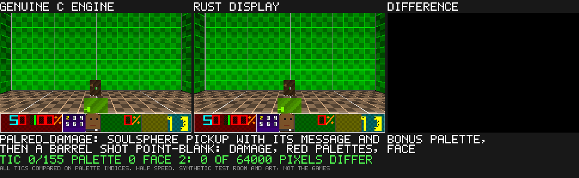
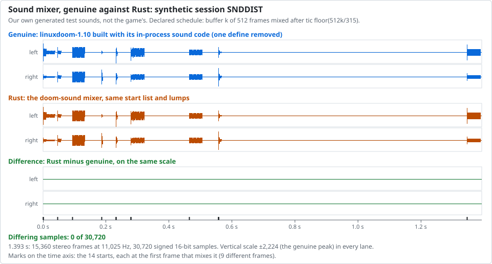

# Rust DOOM

A rewrite of the original DOOM engine in Rust that aims to behave exactly like id
Software's code, down to every single step of game logic. (Rust DOOM is a working title.)

> **Machine-Maintained, Human-Directed Project**
>
> This project is developed and maintained primarily by AI coding agents under
> human direction and oversight. Agents implement code, write tests, maintain
> documentation, and assist with development workflows.
>
> Changes are subject to automated validation and human-defined review
> requirements. AI-generated code can contain mistakes, and passing tests does
> not guarantee correctness. This project is not affiliated with id Software or
> Bethesda.


*A synthetic test run replayed by the original engine's code and the Rust engine, tic by tic, from real values of both ([how](docs/TESTING.md#m4b-synthetic-mechanism-wads)).*


*Both renderers drawing the same walks through three synthetic test rooms (walls, floors, sky, sprites, fuzz) with our own generated test art, not the game's: every frame is byte-identical, so the difference panel stays black ([how](docs/TESTING.md#readme-animations)).*



*The genuine engine and the Rust port play one scripted session on a synthetic room with our own generated test art, not the game's: all 155 tics, with the status bar, message and palette numbers, are identical to the genuine engine under the declared sound-free, wipe-free contract, so the difference panel stays black ([how](docs/TESTING.md#readme-animations)).*



*Our own generated test sounds, not the game's: one synthetic session mixed by linuxdoom-1.10 built with its in-process sound code (one define removed) and by the Rust mixer, under the declared schedule (one 512-frame buffer after tic ⌊512k/315⌋); 0 of 30,720 samples differ ([how](docs/TESTING.md#readme-animations)).*

## Why this exists

Most source ports (modern rewrites of a game's released source code) aim to be playable first and accurate second. This
project works the other way round. It only accepts behavior checked against the original Linux DOOM 1.10 C code (id
Software's 1997 source release), comparing the entire game state after every tic, the 1/35-second step in which DOOM
updates its world. Anything not yet proven identical is refused: the engine stops with an error instead of approximating.

That makes it fit for exact-behavior work once the ground is covered: replaying recorded demos (files of a player's
inputs, which stay in sync only if every tic matches), speedrun and tool-assisted (TAS) research, and studying the
original engine. Vanilla behavior (the original unmodified game, quirks included) is the default, and game math stays in
Doom's whole-number arithmetic (one division aside). Once a behavior is admitted, nothing quietly rounds it differently.

## Where it stands
The engine runs DOOM's game logic, draws the picture and mixes the sound effects; a limited playable build opens one Episode 1 map
in a window. It is checked against the genuine engine (the original C code, run alongside the Rust code) on purpose-built test maps
and, local-only, on your own game files; for sound and the frames that depend on it, that engine is linuxdoom-1.10 built with its
in-process sound code (one define removed), under [a declared schedule](docs/COMPATIBILITY.md#sound-effects-m5c).

- One player with the fist, chainsaw, pistol, shotgun, chaingun and rocket launcher against the Zombieman, Shotgun Guy, Chaingunner,
  Imp, Demon, Spectre and Baron of Hell, with pickups, keys and powerups, and Episode 1's map features: doors, lifts, floors,
  stairs, switches, teleporters, exits, exploding barrels, damaging floors, secrets and lights.
- All nine real Episode 1 maps and the original's own `DEMO1` as run by the original code: every scripted run stays in sync with the
  genuine engine, tic for tic ([which runs and skills](docs/validation/M4B.md#real-maps-and-demo1)).
- A software renderer, status bar, messages, palette flashes, keyboard-and-mouse input and a window at 35 tics a second. Frames, the
  status bar face's idle glance included, equal the genuine engine's replaying the same session's demo, except what is compared only
  in part or not at all ([renderer](docs/COMPATIBILITY.md#software-renderer-m5a), [status
  bar](docs/COMPATIBILITY.md#playable-build-m5b), [with sound](docs/validation/M5C.md)).
- Doom's sound effects (no music): which sounds start, on which channel, at what volume, stereo position and pitch, and the mixer's
  16-bit samples, equal the genuine engine's on [the runs checked](docs/validation/M5C.md). The owner has heard it play ([what he observed](docs/COMPATIBILITY.md#what-the-owner-observed-2026-11-18)); by arithmetic, sound on Windows is
  later than the original's ([latency](docs/COMPATIBILITY.md#sound-latency-arithmetic-not-measured)), and what the speakers add is [not part of
  the claim](docs/COMPATIBILITY.md#the-app-with-sound-and-what-is-presentation).

It cannot yet draw the automap, play music, offer menus, an intermission or a next level, play back the original's recorded demos
(only the one local `DEMO1`), run the other episodes or easy or nightmare skill, or claim a tic-for-tic match for any input beyond
the scripted runs recorded so far. Progress is measured in proven features, not weeks.

## Which kind of Doom?

Four broad ways to play classic Doom; each non-vanilla one would be a separate optional mode.

- **Vanilla.** The original 1993 game, limits and quirks included: what this project builds.
- **Limit-removing.** Same game, but the original's hard limits on map size are lifted (Track 1 below).
- **Boom, MBF21 and ID24.** Extensions adding new doors, lifts and floors: a possible later mode.
- **Advanced, ZDoom-style.** Scripting, slopes and big mods: this project would go its own way (Track 3 below).

## Where it's (maybe) going

Ideas, not promises, one line each; the [roadmap](docs/ROADMAP.md#ideas-under-consideration) has more.

**Track 1: Faithful.** Vanilla stays exact; anything that changes it lives in a separate optional mode.

- **Original demo playback.** Replay vanilla demos to the last tic, the strongest proof of exactness.
- **Faster progress.** Port whole systems at once, checked on real maps and demos.
- **One vanilla mode, plus a limit-removing one.** Fold the policies into one; another lifts limits.
- **An optional "fixed" mode.** Off unless chosen, it would correct known original bugs.
- **The full game and Doom II.** After Episode 1, the other episodes and Doom II, just as exact.

**Track 2: Presentation.** The renderer only reads game state, so it can never change gameplay.

- **A faithful software renderer first.** It would look exactly like the original Linux DOOM 1.10.
- **Then a modern renderer.** Smooth high frame rates between tics, plus sector-based lighting.
- **VR.** A headset handles looking around while the mouse turns and aims.
- **A fully offline engine.** Your own game files, no internet, account or launcher.

**Track 3: Beyond vanilla.** A new engine on the verified core, in separate optional modes.

- **Modern source-port features, done cleanly.** ZDoom-style features on a fresh core.
- **Things the original never simulated.** Flowing water, blood and nukage; huge monster crowds.
- **Scripting and more platforms.** A scripting layer for new game logic; platforms such as mobile.
- **A live editor with rewind.** Change anything while the game runs, then rewind and replay from any moment.
- **"Why did that happen?"** Click a monster and see the exact decisions and random rolls behind what it did.
- **TAS tools that are vanilla-legal by construction.** Runs built frame by frame here play back on the original game.
- **Map and demo checks.** See exactly which line breaks vanilla limits, and which demos a map change desyncs.

## How it's verified
The original C source is the ground truth. Each behavior runs in both the original and the Rust code, and the whole game state is
compared after every tic. Expected results come from a separate program written from the C output alone, so Rust is never checked
against itself; sanitizers, fuzzing and mutation testing back that up. Anything not proven identical is refused, not guessed.

## Play it (limited)
The `doom-play` program opens a window for one Episode 1 map (E1M1 to E1M9; skill `hmp` or `uv`) with your own `DOOM.WAD` (read in
place, never distributed). It is playable only in this limited way: to really play Doom, use an established source port such as
[Chocolate Doom](https://www.chocolate-doom.org/). From the cloned top folder (`--help` lists every option):

```sh
cargo run --release -p doom-play -- --iwad /path/to/DOOM.WAD --map 1 --skill hmp --sessions /path/for/sessions
```

- **Controls.** The original's defaults: arrows move and turn, right Ctrl fires, Space uses, right Shift runs, `1`-`8` pick weapons,
  mouse left fires (`--bindings modern` gives WASD). Esc pauses (R restarts, Q quits), End mutes. No cheat codes.
- **Sessions.** Each is saved as a demo (tiny mouse turns are rounded), never over an existing file, and can be replayed in the
  genuine engine with your IWAD ([how](docs/TESTING.md#m5c-sound-effects-the-genuine-sound-logic-and-mixer)). It is kept current tic by tic (shown on Linux only; if killed it loses the tics still queued for
  the disk: [17 at most on the owner's hard disk, 620 seen once through WSL](docs/validation/M5D.md#the-retest)); on Windows and macOS end one with Esc then Q ([limit](docs/COMPATIBILITY.md#a-session-is-safe-on-windows-and-macos-only-when-doom-play-ends-it-a-limit-not-yet-lifted-there)).
- **Sound.** Under Linux or WSLg install the PulseAudio client library once (`sudo apt install libpulse0`); Windows needs nothing.
  `doom-play --audio-probe` checks the device with silence ([options](docs/COMPATIBILITY.md#sound-effects-m5c)).
- **Limits.** No music, menus, automap, saving, intermission, next level, other skills, multiplayer or menu-key sounds. **An OpenGL
  2.1 (or OpenGL ES 2) driver is required.** Pausing and key release on focus loss are checked only under WSLg (press Esc before
  switching away), where the game sometimes opens paused: Esc resumes ([limits](docs/COMPATIBILITY.md#platform-limits)).
- **What was tried.** The owner, one evening, release builds of one commit. Windows 11: 35 frames a second, the picture right, the mouse captured, sound
  playing. WSLg: sound plays, the pointer is not captured: **keyboard-only for now**. Not judged: macOS, long sessions, every map, weapon and monster,
  vanilla bindings. A Windows fault that left fire stuck after a drag [did not recur in his retest of the fix, though its cause was never reproduced](docs/COMPATIBILITY.md#stuck-fire-on-windows-accepted-as-fixed-in-m5d-the-cause-was-never-reproduced).

## Try it
You need Rust via [rustup](https://rustup.rs/) (stable, or at least 1.85.0) and a C compiler (on Windows, the Visual Studio build
tools). It builds on Linux, Windows and macOS; none of this needs game files, graphics, audio or a network:

```sh
cargo test --workspace --locked
cargo run -p doom-sim --example player_barrels --locked  # exploding barrels, chain reactions, monsters
```

## For developers, contributing and license

New gameplay is switched on by optional policies, one slice of Doom each ([policy table](docs/COMPATIBILITY.md#policies)); the
[documentation index](docs/README.md) has the rest. Contributors read [CONTRIBUTING.md](CONTRIBUTING.md); AI agents follow
[AGENTS.md](AGENTS.md). The project preserves id Software's original source, history and attribution; the Rust workspace is
GPL-2.0-only ([license](LICENSE.TXT), [original README](README.TXT)); game data is never distributed ([assets](docs/ASSETS.md)).
